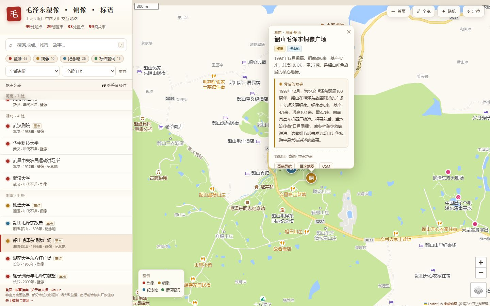
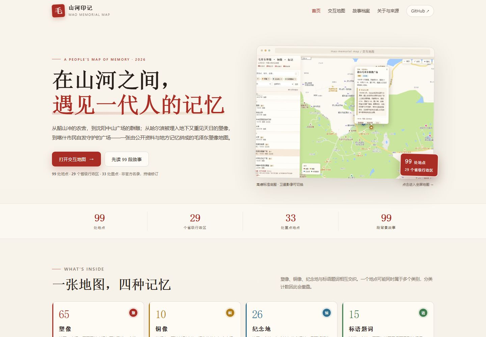

# 山河印记 · 毛泽东塑像与红色地标地图

> 中国大陆 99 处毛泽东塑像、铜像、纪念地与标语题词的交互地图。每个地点都配有一段“背后的故事”。

[在线地图](https://e2168708352-web.github.io/mao-memorial-map/map.html) · [故事档案](https://e2168708352-web.github.io/mao-memorial-map/stories.html) · [关于与来源](https://e2168708352-web.github.io/mao-memorial-map/about.html) · [GitHub Issues](https://github.com/e2168708352-web/mao-memorial-map/issues)





## 这是什么

一张民间整理的历史地理索引，不是官方完整名录。项目把公开可见的毛泽东室外塑像、铜像、故居/纪念馆、革命旧址与相关标语题词放在同一张 Leaflet 地图上，并为每个地点补充一段侧重人物、事件与地方记忆的背景故事。

- **99 处地点**，覆盖 **29 个省级行政区**
- **33 处重点地点**，**99 段背景故事**
- 分类：塑像 65 · 铜像 10 · 纪念地 26 · 标语题词 15（可重叠）
- 支持关键词搜索、分类/省份/年代筛选、聚合标记、卫星底图、随机地点与高德/百度/OSM 导航

## 网站结构

| 页面 | 内容 |
| --- | --- |
| `index.html` | 项目首页：数据概览、分类入口、精选故事、使用说明 |
| `map.html` | 交互地图：筛选、搜索、弹窗故事、导航、定位 |
| `stories.html` | 99 段故事档案：按省份分组，支持关键词与省份筛选 |
| `about.html` | 收录标准、数据来源、坐标处理、已知局限与贡献方式 |
| `scripts/build-stories.js` | 从 `map.html` 的数据生成 `stories.html` |

## 本地预览

项目是纯静态站点，不需要构建。由于地图依赖 Leaflet CDN 与高德瓦片，请联网打开。

```bash
# 在项目根目录启动一个静态服务器
python -m http.server 8080
# 然后访问 http://localhost:8080/
```

也可以直接用浏览器打开 `index.html`；地图页建议通过本地服务器访问，以避免个别浏览器对本地文件的限制。

## 修改数据与重新生成故事页

所有点位、分类与故事都写在 `map.html` 的 `SITES` / `STORIES` 数据块中。修改后运行：

```bash
node scripts/build-stories.js
```

脚本会重新生成 `stories.html`，并输出地点与故事数量。首页中的统计数字与精选故事为手工维护；如果地点总数发生变化，请同步更新 `index.html`、`about.html` 与 `README.md` 中的数字。

## 部署到 GitHub Pages

仓库已包含 `.github/workflows/pages.yml`。推送到 `main` 后，在仓库 **Settings → Pages** 中把 Source 设为 **GitHub Actions**，工作流会自动构建并发布。

预计地址：<https://e2168708352-web.github.io/mao-memorial-map/>

## 数据与边界

- 公开资料中没有“全国现存毛主席塑像”的权威统计；本图按公开报道、校史、地方文物信息与纪念馆展陈整理，必然有遗漏或过时。
- 甘肃、西藏暂未收录到可核实的现存大型室外塑像点位，地图留空，不代表当地一定没有。
- 坐标为 WGS-84 近似值，脚本转换为 GCJ-02 以匹配高德底图；校园、广场、厂区点位通常标在大致位置，实地导航请以导航软件搜索结果为准。
- 塑像可能迁移、拆除、修缮或关闭；校园、军校、营区、医院、厂区等点位不一定对公众开放。
- 故事中的年代、人物与细节可能存在不同版本；涉及口述记忆的段落已用“相传”“当地流传”等字样提示。
- 本项目为民间整理，仅供参观、研究与学习参考，不代表任何机构或官方立场。

主要来源与完整说明见 [about.html](about.html)。

## 参与贡献

欢迎通过 [GitHub Issues](https://github.com/e2168708352-web/mao-memorial-map/issues) 提交：

- 点位迁移、拆除、关闭或重新开放；
- 更准确的地址、坐标、年代、材质与尺寸；
- 遗漏的塑像、铜像、纪念地或标语；
- 故事中的事实错误与可补充的一手来源；
- 页面显示、移动端适配或无障碍改进。

提交时最好附上地点名称、省市县/区、大致坐标或地址、年代、现状，以及至少一条可核实的来源链接。

## 技术栈

- [Leaflet](https://leafletjs.com/) 1.9.4（BSD-2-Clause）
- [Leaflet.markercluster](https://github.com/Leaflet/Leaflet.markercluster) 1.5.3（MIT）
- 高德地图标准/卫星瓦片（遵循高德服务条款）
- 原生 HTML / CSS / JavaScript，无后端、无构建依赖

## 许可

代码与生成脚本以 [MIT License](LICENSE) 开源。地图数据与故事文本由项目整理，引用时请注明“山河印记 / mao-memorial-map”，并尽可能回到原始来源核对。底图瓦片版权归高德地图所有，本项目不存储或再分发瓦片图片。
